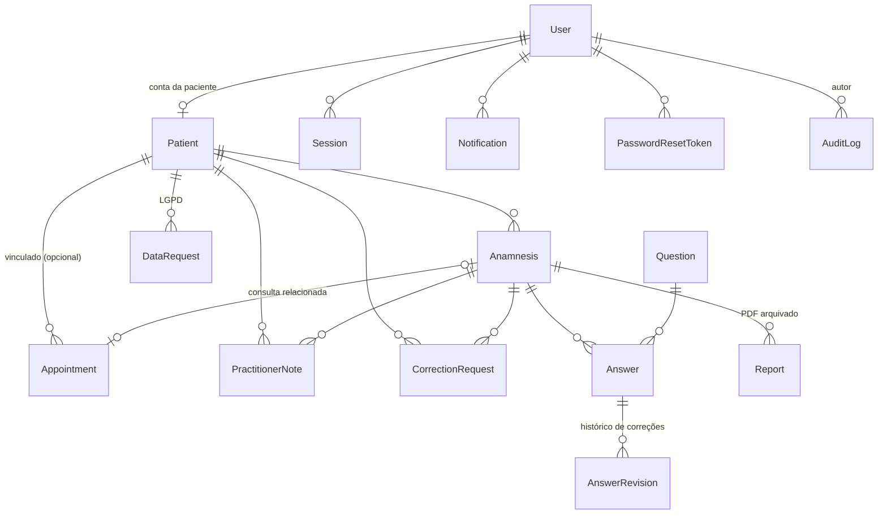

# Flor de Lótus — Plataforma de Pacientes e Anamneses

Aplicação web da **Flor de Lótus – Yoga e Ayurveda para Mulheres** que substitui o Google Forms: as pacientes criam conta, preenchem e acompanham suas anamneses; a profissional administra pacientes, anamneses, correções, relatórios, agenda e notificações.

---

## 1. Tecnologias

| Camada | Escolha | Por quê |
|---|---|---|
| Framework | **Next.js 15** (App Router, Server Components, Server Actions) + **React 19** + **TypeScript** | Frontend e backend no mesmo projeto, com regras de negócio executadas só no servidor |
| Banco / ORM | **Prisma 7** + **SQLite** (driver `better-sqlite3`) | Migrações versionadas, consultas parametrizadas; SQLite é suficiente para uma única profissional e fácil de fazer backup. Troca para PostgreSQL documentada abaixo |
| Estilo | **Tailwind CSS 3** + fontes locais (Cormorant Garamond e Nunito) | Paleta sálvia/oliva/bege/off-white; nenhuma fonte carregada de terceiros |
| Validação | **Zod** (no servidor) | Toda entrada é validada no backend |
| Senhas | **bcrypt** (custo 12) | Hash seguro |
| PDF | **PDFKit** (gerado no servidor) | Cabeçalho com identidade visual, identificação, data e paginação |
| Testes | **Vitest** (regras de negócio) + **Playwright** (navegador real) | 26 testes de unidade/integração + 21 fluxos ponta a ponta |

## 2. Estrutura do projeto

```
flor-de-lotus/
├── prisma/
│   ├── schema.prisma          # modelo de dados
│   ├── migrations/            # migrações SQL versionadas
│   └── seed.ts                # cadastra as 20 perguntas (idempotente)
├── scripts/
│   ├── create-admin.ts        # provisiona a ÚNICA conta administrativa
│   ├── reset-admin-password.ts
│   ├── run-deadline-sweep.ts  # avisos de prazo (agendável via cron)
│   ├── backup-db.ts           # backup do SQLite
│   └── demo-seed.ts           # dados FICTÍCIOS para demonstração
├── src/
│   ├── app/
│   │   ├── (public)/          # landing, cadastro, login, recuperar senha, privacidade, acesso profissional
│   │   ├── paciente/          # área da paciente (dashboard, questionário, revisão, conta, notificações)
│   │   ├── admin/             # painel (visão geral, pacientes, anamneses, liberar, agenda, solicitações, relatórios, notificações, auditoria)
│   │   ├── api/               # downloads protegidos (PDFs e exportação LGPD)
│   │   └── actions/           # Server Actions (camada fina: autenticação + chamada aos serviços)
│   ├── server/
│   │   ├── session.ts         # sessões, RBAC (requireAdmin / requirePatient)
│   │   ├── services/          # REGRAS DE NEGÓCIO (contas, anamneses, correções, prazos, agenda, relatórios, LGPD, auditoria, notificações)
│   │   └── admin-queries.ts   # consultas do painel
│   ├── components/            # componentes reutilizáveis (questionário, formulários, sino de notificações…)
│   ├── lib/                   # perguntas, datas/prazo, status, validação, segurança
│   └── middleware.ts          # barreira rápida para rotas restritas
├── tests/                     # Vitest (usa banco de teste próprio)
└── e2e/smoke.mjs              # fluxos ponta a ponta no navegador
```

Separação: **páginas/ações** → **serviços (`src/server/services`)** → **Prisma**. Nenhuma regra de negócio depende do frontend.

## 3. Modelo de dados



| Entidade | Conteúdo |
|---|---|
| `User` | e-mail (único), hash da senha, papel `ADMIN`/`PATIENT` |
| `Session` | sessões no banco (apenas o hash SHA-256 do token) |
| `Patient` | nome completo, como gosta de ser chamada, data/versão do consentimento |
| `Question` | 20 perguntas: enunciado original, categoria, ordem, tipo de campo, obrigatoriedade, opções “Não se aplica”/“Prefiro não responder” |
| `Anamnesis` | registro independente por liberação: nº sequencial, situação, consulta, **prazo (48h antes)**, datas de início/salvamento/envio, envio fora do prazo, revisão |
| `Answer` | uma resposta por pergunta por anamnese (`@@unique[anamnesisId, questionId]`) |
| `AnswerRevision` | valor anterior e novo, motivo, responsável e data — correções nunca sobrescrevem em silêncio |
| `PractitionerNote` | observações exclusivamente internas |
| `CorrectionRequest` | pedidos da paciente e pedidos de esclarecimento da profissional, com status e retorno |
| `Appointment` | agenda interna: data/hora, duração, título, descrição, observações privadas, status |
| `Notification` | notificações internas por usuária, com data de leitura |
| `Report` | PDFs gerados (armazenados no banco, nunca em pasta pública) |
| `DataRequest` | solicitações LGPD (acesso, correção, exclusão) |
| `AuditLog` | ações importantes (sem conteúdo das respostas) |

“Atrasada” não é gravada: é **derivada** (não enviada + prazo vencido), então nunca fica desatualizada.

## 4. Instalação e execução (desenvolvimento)

Requisitos: **Node.js 20 ou 22** e npm.

```bash
npm install                    # também roda "prisma generate"
cp .env.example .env           # ajuste as variáveis
npx prisma migrate deploy      # cria o banco (dev.db) a partir das migrações
npm run db:seed                # cadastra as 20 perguntas
npm run admin:create           # cria a conta da profissional (ver seção 5)
npm run dev                    # http://localhost:3000
```

Para demonstrar com dados **fictícios** (pacientes de exemplo em vários estados, agenda e uma solicitação de correção):

```bash
npm run db:demo
# profissional (se ainda não houver conta admin): profissional@demo.flordelotus.test / DemoLotus2026!
# pacientes: helena@, marina@, julia@, beatriz@demo.flordelotus.test / paciente123
```

## 5. Configuração da conta administrativa

Não existe cadastro administrativo público. A conta é criada uma única vez pelo terminal do servidor:

```bash
ADMIN_EMAIL="profissional@seudominio.com.br" \
ADMIN_PASSWORD="uma-senha-forte-com-12+-caracteres" \
ADMIN_NAME="Nome da Profissional" \
npm run admin:create
```

- O script **recusa** criar uma segunda conta administrativa.
- Exige senha com 12+ caracteres, letras e números.
- Depois, **remova** `ADMIN_PASSWORD` do ambiente.
- O login da profissional fica em `/acesso-profissional` (link discreto no rodapé).
- Esqueceu a senha? `ADMIN_PASSWORD="nova" npm run admin:reset-password` (encerra todas as sessões).

## 6. Variáveis de ambiente

| Variável | Uso |
|---|---|
| `DATABASE_URL` | `file:./dev.db` (SQLite) |
| `APP_URL` | URL pública — usada no link de redefinição de senha |
| `APP_TIMEZONE` | fuso das datas digitadas (padrão `America/Sao_Paulo`) |
| `PRIVACY_CONTROLLER_NAME`, `PRIVACY_CONTACT` | identificação da controladora na Política de Privacidade |
| `ADMIN_EMAIL`, `ADMIN_PASSWORD`, `ADMIN_NAME` | apenas para `admin:create` |

## 7. Produção

```bash
npm ci
npx prisma migrate deploy
npm run db:seed
npm run build
NODE_ENV=production npm start      # porta 3000, atrás de um proxy HTTPS
```

- **HTTPS obrigatório**: publique atrás de Nginx/Caddy (ou plataforma com TLS). Em produção o cookie de sessão é `Secure` e o cabeçalho HSTS é enviado.
- **Avisos de prazo**: são gerados automaticamente quando os painéis são acessados; para garantir pontualidade, agende `npm run jobs:deadlines` (ex.: cron a cada 15 min).
- **Backups**: `npm run db:backup` gera cópia consistente em `./backups` (permissão 600). Agende diariamente e copie para um local externo criptografado.
- **Uma instância**: o limitador de tentativas de login fica em memória; para várias instâncias, use Redis.
- **PostgreSQL** (opcional): troque `provider = "sqlite"` por `"postgresql"` em `prisma/schema.prisma`, instale `@prisma/adapter-pg` e `pg`, troque o adapter em `src/lib/db.ts` (`new PrismaPg({ connectionString })`), apague `prisma/migrations` e rode `npx prisma migrate dev --name init` para gerar a migração do novo banco. Backup com `pg_dump`.

## 8. Segurança e LGPD

- Senhas com bcrypt; nunca armazenadas ou registradas em texto.
- Sessões em banco com token aleatório (só o hash é guardado), cookie `HttpOnly`/`SameSite=Lax`/`Secure`, expiração de 7 dias com renovação, logout que apaga a sessão.
- **RBAC no servidor**: toda página, Server Action e rota de API verifica papel e posse do dado (`requireAdmin`, `requirePatient`, consultas sempre filtradas por `patientId`). O middleware é apenas uma barreira extra.
- Isolamento: uma paciente que tenta abrir anamnese de outra recebe “não encontrada” (não revela que existe).
- SQL Injection: apenas consultas parametrizadas do Prisma. XSS: React escapa conteúdo; CSP restritiva. CSRF: Server Actions verificam a origem; cookies `SameSite`.
- Cabeçalhos: CSP, `X-Frame-Options: DENY`, `nosniff`, `Referrer-Policy`, `Permissions-Policy`, HSTS.
- Limite de tentativas em login, cadastro e recuperação de senha; mensagens que não revelam se um e-mail existe.
- PDFs e exportações só por rotas autenticadas, `Cache-Control: no-store`; nenhum arquivo em pasta pública.
- Consentimento específico registrado com data e versão da política; página `/privacidade`.
- Direitos da titular: exportação dos próprios dados (JSON), solicitações de acesso/correção/exclusão, exclusão definitiva pela profissional (com confirmação; agenda é anonimizada; auditoria mantida sem dados pessoais).
- Auditoria de liberações, envios, correções, acessos administrativos, relatórios, exclusões.
- **Não use dados reais em teste/demonstração** — o `demo-seed` só cria dados fictícios e recusa rodar com `NODE_ENV=production`.

> A Política de Privacidade incluída é um modelo de partida; recomenda-se revisão jurídica antes do uso real, especialmente sobre prazos de retenção.

## 9. Testes

```bash
npm test            # Vitest: 26 testes em banco de teste isolado (test.db)
npm run typecheck   # TypeScript
# Ponta a ponta (com o servidor rodando e dados de demonstração):
CHROME_PATH=/caminho/do/chrome npm run test:e2e
```

**Unidade/integração (26/26 aprovados)** — cálculo das 48h (incluindo o exemplo 20/11/2026 14h → 18/11/2026 14h e virada de mês), fuso, status atrasada; cadastro, e-mail inválido/duplicado, senha fraca, hash, login, recuperação de senha com link de uso único; 20 perguntas com redação original; salvamento automático e retomada; “Não se aplica” só onde permitido; bloqueio de envio incompleto; envio fecha o registro; nova liberação não altera anteriores; envio após o prazo permitido e notificado; avisos de prazo emitidos uma única vez; remarcação recalcula prazo; isolamento entre pacientes; correção preserva histórico e responsável; esclarecimento e resposta; revisão não altera respostas; relatórios com 20 perguntas e sem observações privadas; PDF válido; exportação e exclusão LGPD.

**Ponta a ponta no navegador (21/21 aprovados)** — landing; cadastro com validações; convite à primeira anamnese; sair e continuar; preenchimento completo com revisão e confirmação; registro fechado; pedido de correção; paciente bloqueada no painel/PDFs administrativos/dados alheios; contador e marcação de notificações; download do PDF; logout; login de paciente recusado na área profissional; painel; nova paciente na listagem e busca; observação privada e marcação de revisada; correção com histórico; relatórios completo/resumido sem observações e geração de PDF; liberação com prazo 18/11/2026 14h; agenda dia/semana/mês, cadastro e “realizado”; notificações da profissional; layout mobile.

## 10. Funcionalidades implementadas

**Paciente**: cadastro público com consentimento; login/logout; recuperação de senha; dashboard com saudação pelo nome preferido, anamnese atual, prazo, aviso de nova anamnese, histórico e notificações; questionário em 8 etapas com barra de progresso, navegação, salvamento automático (com nova tentativa se a conexão cair), indicadores de obrigatoriedade, “Não se aplica”/“Prefiro não responder” em perguntas sensíveis, revisão e confirmação; visualização das anamneses enviadas e PDF; pedidos de correção e respostas a esclarecimentos; edição de dados, troca de senha, exportação e solicitações LGPD.

**Profissional**: visão geral com indicadores e gráfico discreto; listagem de pacientes com busca e filtro; ficha individual; anamneses com filtros por paciente/data/situação/novas; leitura por categoria; observações privadas; correções com histórico; pedidos de esclarecimento; marcação de revisada; vinculação de consulta à primeira anamnese; liberação de novas anamneses (inclusive a partir de um compromisso); relatórios completo e resumido no painel, impressão e PDFs arquivados; agenda dia/semana/mês sem horários fixos; notificações internas; solicitações; link de redefinição de senha para a paciente; exclusão de dados; registro de auditoria.

## 11. Decisões e limitações

- **Recuperação de senha sem e-mail**: como e-mails automáticos estão fora do escopo, a paciente registra o pedido, a profissional é notificada e gera na ficha um link pessoal (24h, uso único) para enviar pelo canal habitual (ex.: WhatsApp).
- **Relatório resumido sem IA**: reorganiza as respostas por tema e preserva as palavras da paciente, sem interpretação; o relatório completo nunca é substituído.
- **Observações internas** não entram na exportação LGPD da paciente, por regra de negócio do projeto — avalie juridicamente se isso atende ao seu caso.
- **Avisos de prazo** dependem de acesso aos painéis ou do cron `jobs:deadlines`.
- **Editar o questionário** (perguntas) é feito em `src/lib/questions.ts` + `npm run db:seed`; não há tela para isso, para proteger a redação original.
- Uma única instância de servidor (limitador de tentativas em memória).
- A migração inicial foi gerada pelo motor de esquema oficial do Prisma; em uma máquina comum, `prisma migrate dev`/`deploy` funcionam normalmente.
